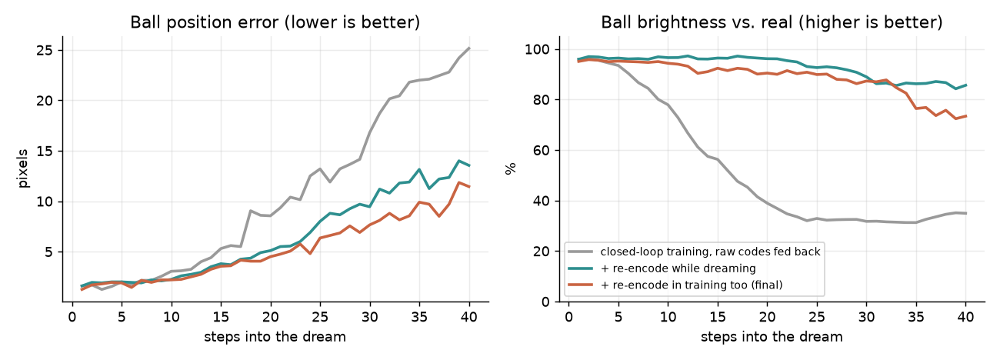

# Lessons: what the basic approach misses

The "obvious" world model is three steps: compress each frame, predict the next code, decode it.
Every step of that plan breaks in a specific, instructive way. This page records each failure,
the fix used in this repo, and the general rule behind it.

Each lesson follows the same pattern:

> **Basic thinking** → **what actually happens** → **fix** → **the general rule**

---

## 1. The loss decides what the model learns

| | |
|---|---|
| **Basic thinking** | Train the autoencoder until the reconstruction error is low. |
| **What happens** | The ball is ~10 pixels out of 1,024. Dropping it entirely barely changes the loss, so the model learns a perfect background and paddle and **no ball**. |
| **Fix** | Pixels that differ from the background get a 20× weight in the loss (`utils.object_weight`). |
| **Rule** | **A model learns what the loss pays for, not what you care about.** Before training, ask: *"if the model ignored the most important thing, would the loss even notice?"* |

## 2. Judge a representation by how it will be used

| | |
|---|---|
| **Basic thinking** | If the decoder redraws frames well, the codes are good. |
| **What happens** | Two frames where the ball moved one pixel can get completely different codes and still decode perfectly. The dynamics model then has to predict large, erratic jumps. |
| **Fix** | A smoothness term pulls the codes of consecutive frames together (`train_autoencoder.py`). |
| **Rule** | **A representation is only as good as the task that consumes it.** These codes are going to be *predicted*, so they must be easy to move through, not just easy to decode. |

## 3. Train on the inputs you will actually get

| | |
|---|---|
| **Basic thinking** | Train the decoder on the encoder's exact codes. |
| **What happens** | Predicted codes are never exact; they land *near* real codes, where the decoder has never been trained, and it draws blur or loses the ball. |
| **Fix** | During training the decoder also sees slightly noisy codes (`code_noise=0.1`). |
| **Rule** | **Train each component on the distribution it will see at test time,** not the clean one. |

## 4. An observation is not the state

| | |
|---|---|
| **Basic thinking** | Frame in, next frame out. |
| **What happens** | A single frame shows *where* the ball is, not *where it is going*. The same frame can be followed by a move left or right, so the model cannot do better than guess. |
| **Fix** | The dynamics model is a GRU. Its memory has seen the previous frames and can recover velocity from the difference. |
| **Rule** | **Ask whether the input actually contains everything needed to predict the output.** If not, the model needs memory. |

## 5. Check the scale of everything inside a loss

| | |
|---|---|
| **Basic thinking** | Mean squared error over all latent dimensions. |
| **What happens** | Dimensions describing the large paddle vary a lot; those describing the tiny ball vary a little. Plain MSE spends its effort on the paddle. |
| **Fix** | Each latent dimension is normalised to zero mean and unit variance before training the dynamics model. |
| **Rule** | **Big numbers win by default, not because they matter.** Normalise, or weight deliberately. |

## 6. One-step accuracy is not long-horizon accuracy

| | |
|---|---|
| **Basic thinking** | If the model predicts one step ahead well, chain its predictions for long rollouts. |
| **What happens** | During training the model always receives the *real* previous code. While dreaming it receives its *own* slightly wrong prediction. It never practised recovering, so errors compound and the ball drifts away within a few dozen steps. This is called **exposure bias**. |
| **Fix** | Two changes in `train_dynamics.py`: small noise on the inputs during one-step training, so the model learns to *correct* errors, and **closed-loop training**, where the model must run 5, then 15, then 30 steps on its own predictions, with a pixel loss through the frozen decoder. |
| **Rule** | **Train under the conditions you will deploy in.** |

**Measured in this repo:** see the table under lesson 8, where closed-loop training alone is the baseline.

## 7. Make the easy answer easy to express

| | |
|---|---|
| **Basic thinking** | The network outputs the next code `z_{t+1}` directly. |
| **What happens** | Most of the scene does not change between frames, but the network must reproduce all of it every step. When unsure, it averages, and the ball fades. |
| **Fix** | The network predicts the *change*, `z_{t+1} − z_t`. "Nothing moves" becomes the default. |
| **Rule** | **Parameterise the output so the common case is the simple case.** It's the same idea that makes residual networks work. |

## 8. Keep the model on the data it knows

| | |
|---|---|
| **Basic thinking** | While dreaming, feed the predicted code straight back in as the next input. |
| **What happens** | Each prediction lands slightly off the set of codes that real frames produce. Off that set, the decoder has never learned what to draw, and the model never learned what comes next. The errors carry the code further away every step, and the ball **fades into blur** within ~15 steps, even though the paddle stays correct. |
| **Fix** | **Re-encoding:** after each imagined step, decode the frame and encode it again. The encoder can only output codes that look like real frames, so this snaps the code back onto familiar ground. The same projection is used inside closed-loop training, so the model learns to work with it. |
| **Rule** | **Errors are worst where the model has never been.** When outputs are fed back as inputs, keep them in the region the model was trained on: project, clip, or re-encode. |

**Measured in this repo** (20 unseen test episodes, 10 warm-up frames, then the model dreams on its own):

| Steps into the dream | 1 | 5 | 10 | 20 | 30 | 40 |
|---|:-:|:-:|:-:|:-:|:-:|:-:|
| Ball error, closed-loop training only (px) | 1.6 | 2.0 | 3.0 | 8.6 | 16.8 | 25.1 |
| + re-encode while dreaming (px) | 1.6 | 2.0 | 2.2 | 5.1 | 9.4 | 13.6 |
| + re-encode in training too (px) | 1.2 | 1.9 | 2.2 | 4.5 | 7.7 | 11.4 |
| Ball brightness, closed-loop training only | 96% | 93% | 78% | **39%** | 32% | 35% |
| + re-encode while dreaming | 96% | 96% | 97% | **96%** | 89% | 86% |
| + re-encode in training too | 95% | 95% | 94% | **90%** | 87% | 73% |

Re-encoding is the single biggest improvement: the ball stays visible instead of fading. Using it in training as well improves position accuracy, at a small cost in brightness after ~30 steps.

---

## How to think about any model like this

Basic thinking checks whether each part works **on its own**. The fixes above all came from asking four questions instead:

1. **What will this part receive at test time,** and did it train on that?
2. **What does the loss actually reward,** and is that what I want?
3. **Does the input contain everything needed** to predict the output?
4. **What happens when errors chain together** over many steps?

## Open problems this repo does not solve yet

- **Drift is reduced, not removed.** The ball's *position* still drifts (~11 px after 40 steps), especially after fast bounces near corners. The autoencoder and dynamics model are trained separately, so the codes are never shaped for prediction from the start. Training them jointly (as Dreamer-style models do) is the natural next step.
- **The world is deterministic.** With real randomness (for example, a ball that respawns at a random place), a deterministic predictor would output the *average* of all possible futures, a blurry future that never happens. Stochastic latents or mixture outputs are needed for that.
- **No agent yet.** The world model is learned, but nothing is trained to *act* inside it.
