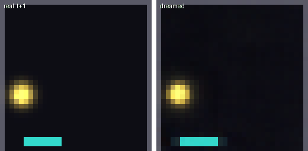
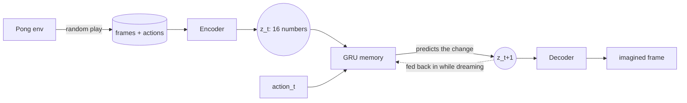
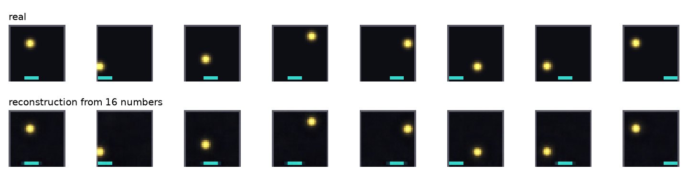
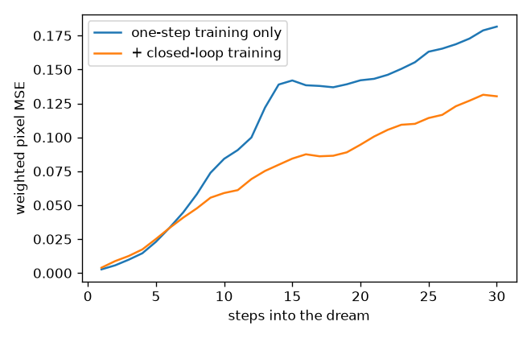
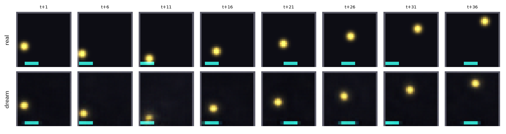

<div align="center">

# 🏓 Pong World Model

**A neural network that learns how a Pong game works by watching it, then plays the game inside its own imagination.**




*Left: the real game. Right: the world model's imagined rollout. After 10 real frames, the game engine is switched off and the model predicts every frame from its own previous predictions, given only the actions.*

</div>

---

## ✨ At a glance

| | |
|---|---|
| 🎮 **World** | A 32 × 32 RGB Pong game: paddle, glowing ball, walls, 3 actions |
| 🗜️ **Compression** | Conv autoencoder: 3,072 pixels → **16 numbers** → 3,072 pixels |
| 🧠 **Memory + prediction** | GRU dynamics model: `(z_t, action_t, memory) → z_{t+1}` |
| 🔁 **Training trick** | Closed-loop training on its own predictions: **~30% less drift** |
| 📏 **Accuracy** | Ball reconstructed within **~1.4 px**; dreamed ball within **~2–3 px for 10 steps** |
| ⏱️ **Cost** | Whole pipeline in **~6 minutes on a laptop CPU**, no GPU |

---

## 🧩 How it works



1. **Collect:** play the game randomly with "sticky" actions (keys are held, as a human would) and record 200 episodes × 120 steps.
2. **Compress:** an autoencoder squeezes each frame into 16 numbers. The loss weights the tiny ball 20× more, keeps consecutive frames close in code space, and trains the decoder on slightly noisy codes.
3. **Predict:** one frame shows *where* the ball is, never *where it's going*, so the dynamics model is a **GRU** whose memory recovers the velocity. It predicts the *change* in the code.
4. **Dream:** warm up the memory on 10 real frames, switch the game off, and let the model run on its own predictions.

> 📖 **Why each of these details is needed, and what breaks without it:** see **[LESSONS.md](LESSONS.md)**.

---

## 📊 Results

<table>
<tr>
<td align="center"><b>Autoencoder: real vs. reconstruction</b><br></td>
<td align="center"><b>Dream error: one-step vs. closed-loop training</b><br></td>
</tr>
</table>

**Dream vs. reality,** every 5th frame after the engine is switched off:



| Steps into the dream | 1 | 5 | 10 | 20 | 30 |
|---|:-:|:-:|:-:|:-:|:-:|
| One-step training only | 0.0027 | 0.0230 | 0.0842 | 0.1420 | 0.1816 |
| **+ closed-loop training** | 0.0039 | 0.0251 | **0.0590** | **0.0946** | **0.1303** |

<sub>Object-weighted pixel MSE on 20 unseen test episodes (lower is better).</sub>

**Honest reading:**
- ✅ The **paddle obeys the actions** for the whole rollout.
- ✅ The **ball is tracked accurately for ~10 steps**, including bounces off the walls.
- ⚠️ After that, small errors compound and the imagined ball fades. This **compounding-error problem** is the central open problem of world models. Closed-loop training reduces it by ~30% but does not remove it.

---

## 🚀 Quickstart

```bash
git clone https://github.com/varun00077/PONG-world-model.git
cd PONG-world-model
pip install -r requirements.txt

python collect_data.py        # ~3 s   · 200 train + 20 test episodes
python train_autoencoder.py   # ~4 min · frame -> 16 numbers -> frame
python train_dynamics.py      # ~1 min · one-step, then closed-loop training
python dream.py               # GIF + plots in outputs/
```

Useful options:

```bash
python dream.py --episode 3 --context 10 --horizon 60      # dream longer on another episode
python train_dynamics.py --closed-epochs-short 0 --closed-epochs-long 0   # ablation: no closed-loop
```

---

## 🗂️ Project structure

```text
PONG-world-model/
├── pong_game_env.py       🎮 the Pong environment
├── collect_data.py        1️⃣ random play -> data/pong_{train,test}.npz
├── models.py              🧱 Encoder, Decoder, AutoEncoder, GRU Dynamics
├── train_autoencoder.py   2️⃣ compression with object weighting, smoothness, code noise
├── train_dynamics.py      3️⃣ one-step + closed-loop training, before/after evaluation
├── dream.py               4️⃣ imagined rollouts vs. reality (GIF + plots)
├── utils.py               🔧 seeding, data loading, weighted losses
├── outputs/               🖼️ figures and GIF shown in this README
├── LESSONS.md             📖 what the basic approach misses, and why
└── requirements.txt
```

---

## 🎮 The environment

| Property | Value |
|---|---|
| Observation | 32 × 32 × 3 RGB, `float32` in [0, 1] |
| Actions | `0` left · `1` stay · `2` right |
| Episode length | 120 steps |
| Physics | Deterministic after reset; continuous ball position rendered as a soft glow |

```python
from pong_game_env import My_pong

env = My_pong(seed=42)
obs = env.reset()                    # (32, 32, 3)
obs, done = env.step(env.RIGHT)
print(env.last_hit)                  # did the paddle hit the ball this step?
```

---

## 🛣️ Roadmap

- [x] Pong environment with RGB rendering
- [x] Data collection with sticky random actions
- [x] Autoencoder with object-weighted, smooth latent space
- [x] GRU dynamics model predicting latent changes
- [x] Closed-loop training to reduce compounding error
- [x] Dream rollouts with quantitative evaluation
- [ ] Train encoder and dynamics **jointly**, so codes are shaped for prediction
- [ ] **Stochastic** dynamics for a world with randomness
- [ ] Train a **controller inside the dream** and test it in the real game
- [ ] **Multi-agent** Pong (two paddles)

---

<div align="center">

**📖 Read next: [LESSONS.md](LESSONS.md)**, seven things the basic approach misses and how to think about them.

</div>
